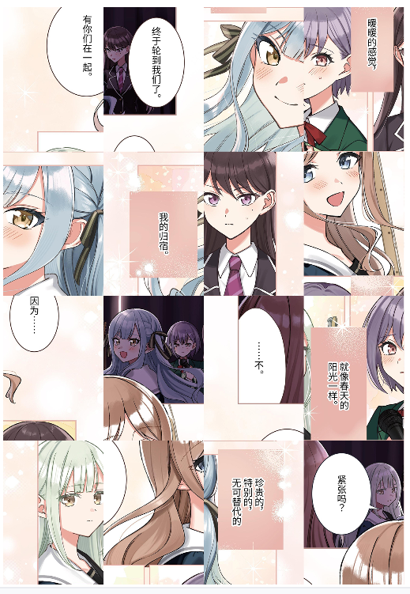
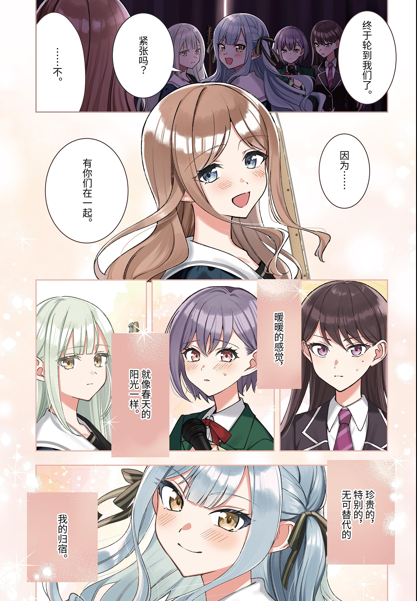
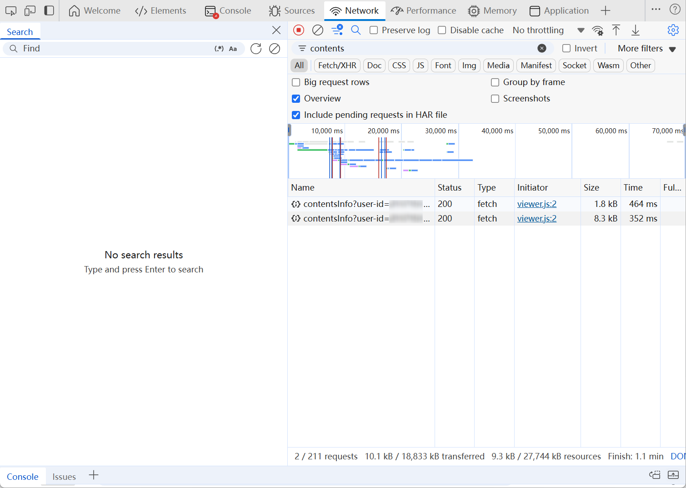
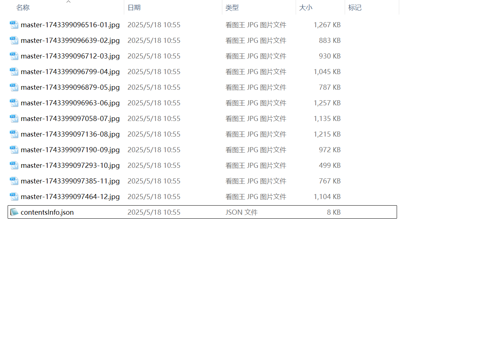

# Readme
## 简介
这是一个 Python 小工具，用来还原被混淆的漫画图片。

众所周知，在武士道旗下的漫画连载平台 Comic Growl 上有 MyGO 和 Ave Mujica 的连载漫画，并且可以免费阅读大部分。因此，我想要将这些漫画下载收藏。但是，直接下载的漫画图片是拼图式的图片碎片（**Tile Sheet**），并不是漫画的完整页面，而是将一页内容分成了若干小块打乱后拼接在一起，这是一种常见的**反爬虫混淆技术**。



所以，这个项目就诞生了。原理很简单，先切片再重排序。


这是仅供我个人使用的小工具，并且 **Powered by GPT**，所以整个 项目/仓库 看上去会很“粗糙”。如果你愿意，你可以提交 PR.

## 使用方法
### 前提条件
- [uv](https://docs.astral.sh/uv/getting-started/installation/)
- 下载某一话的所有图片，文件名为 `master-xxxxx-xx.jpg`
- 下载该话的 `contentsInfo.json` 文件




### 运行
首次使用时，在项目根目录执行：

```bash
uv sync
```

#### 方式一：自动启动 Edge、保存 Cookie 并全流程抓取（推荐）
无需手动配置远程调试端口，程序会直接调用系统已安装的 Microsoft Edge，并将登录态持久化到 `.edge-profile/` 和 `cookies.json`：

1. **（可选，仅需执行一次）登录并保存 Cookie**（如果需要抓取登录/已购/待机免费话数）：
   ```bash
   uv run main.py --login
   ```
   在弹出的 Edge 窗口中完成 Comic Growl 登录，回到终端按回车即可自动保存 Cookie。

2. **自动抓取整部系列或单话**：
   - 双击 `run.bat`（或执行 `uv run main.py`）按菜单选择，默认系列链接已预设为《BanG Dream! It's MyGO!!!!! 雨中祈晴》。
   - 或直接用命令行全自动运行：

```bash
# 抓取系列中所有免费话数（带断点续传，已下载的自动跳过）
uv run main.py --series "https://comic-growl.com/series/762be67a2ce92" --select free

# 登录后抓取系列中所有已解锁/免费话数（未解锁的自动跳过），可加 --headless 无窗口静默运行
uv run main.py --series "https://comic-growl.com/series/762be67a2ce92" --select all --headless

# 仅抓取指定话数范围（例如第 1~5 话）
uv run main.py --series "https://comic-growl.com/series/762be67a2ce92" --select 1-5

# 抓取单话
uv run main.py --url "https://comic-growl.com/episodes/6e043cd6ebc5b"
```

#### 方式二：手动放入 `origin` 文件夹（原模式）
将图片和 `contentsInfo.json` 放入 `origin` 文件夹中，然后执行：

```bash
uv run main.py --local
```

或运行对应系统的启动脚本（macOS/Linux `./run.sh`，Windows `run.bat`）后选择选项 `4`，处理好的图片会生成在当前目录的 `restored`（或自定义话数名）文件夹下。

## 文件结构与用途说明
- `main.py`：主入口，提供命令行参数与交互式菜单，串联登录、系列/单话抓取、本地模式与拼图还原流程
- `browser_fetcher.py`：Playwright 驱动 Microsoft Edge 模块，负责 Cookie 持久化、系列全话展开、`contentsInfo` 捕获、原图下载与抓取前本地页数校验
- `extract_list.py`：解析 `origin/contentsInfo.json`，提取每页 4×4 拼图打乱顺序
- `rename.py`：将手动下载的 `master-xxxxx-xx.jpg` 规范重命名为按序编号的 `.jpg`
- `restore_images.py`：将 4×4 打乱的拼图切片并按 `scramble` 映射重新拼接为完整 `.png`
- `pyproject.toml` / `uv.lock`：`uv` 项目配置与依赖锁文件
- `run.bat` / `run.sh`：Windows / macOS & Linux 启动脚本
